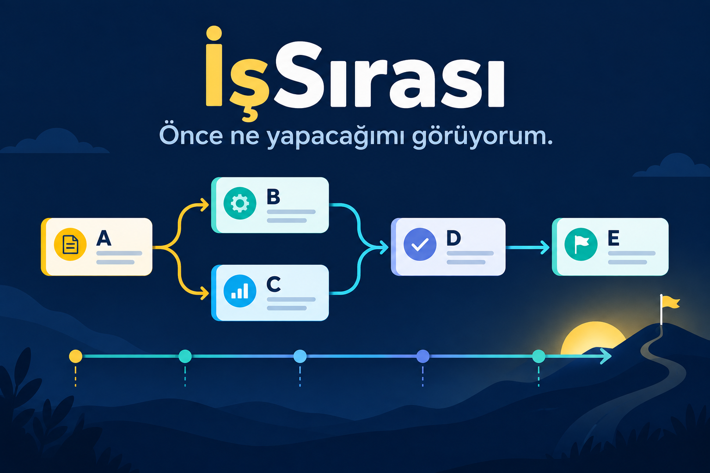

# İşSırası

> Ben önce ne yapacağımı görüyorum.

Ben bazen küçük bir işte bile sırayı karıştırıyorum. “Boyadan önce duvarı korumalı mıydım?” diye düşünüyorum. Aklıma bu geldi: Ben işleri küçük kartlara yazayım. Hangi iş hangisini bekliyor, bilgisayarım bana göstersin.

Ben **İşSırası** aracını yaptım. Ben iş adı, dakika ve önce bitmesi gereken işlerin kodlarını giriyorum. Sonra en erken bitiş süresini ve aynı anda yapılabilecek işleri görüyorum. Ben iş planımı ekranda okuyup kopyalayabiliyorum.

## Ben kime yardım ediyorum?

Ben küçük tadilat ekibine, etkinlik hazırlayanlara, atölyeye ve evde iş bölüşenlere yardım etmek istiyorum. Bir sürü iş ve birkaç kişi olunca sıra kolayca karışabiliyor.

## Ben nasıl kullanıyorum?

1. Ben `index.html` dosyasını tarayıcımda açıyorum.
2. Ben her işe `A`, `B`, `C` gibi kısa bir kod veriyorum.
3. Ben iş adını ve kaç dakika süreceğini yazıyorum.
4. Bir işin önce başka iş beklemesi gerekiyorsa ben o kodları **Önce biten kodlar** kutusuna yazıyorum. Birkaç kodu virgülle ayırıyorum.
5. Ben **Sıramı bul** düğmesine basıyorum.
6. Ben başlangıç ve bitiş saatlerini, en uzun zorunlu yolu ve kopyalanabilir planımı görüyorum.

Ben ilk deneme için **Örnek doldur** düğmesine basabiliyorum. Ben yanlış yazdıysam kutuları değiştirip yeniden hesaplıyorum.

## Benim denediğim gerçek örnek

Ben şu küçük kurulum işini girdim:

| Kod | Benim işim | Süre | Önce |
| --- | --- | ---: | --- |
| A | Ölçü al | 20 dk | yok |
| B | Malzemeyi hazırla | 30 dk | A |
| C | Alanı koru | 15 dk | A |
| D | Kurulumu yap | 45 dk | B, C |
| E | Son kontrol | 10 dk | D |

Benim planımda **B ve C birlikte başlayabiliyor**. Ben hepsini tek tek yapsam 120 dakika sürer. Yeterli kişi ve araç varsa en erken bitiş **105 dakika** oluyor. Benim en uzun zorunlu yolum `A → B → D → E`.

## Benim aracım nasıl düşünüyor?

Ben önce bütün iş kodlarını kontrol ediyorum. Olmayan bir kod yazdıysam bunu görüyorum. İki iş birbirini bekliyorsa bu karışıklığı da görüyorum. Sonra önce bitmesi gereken işleri sıraya koyuyorum. Her işin en erken başlayabileceği dakikayı buluyorum. En geç biten işin süresini toplam süre olarak yazıyorum.

Ben en fazla 40 iş ve iş başına en fazla 1.440 dakika kabul ediyorum. Ben gerçek takvimi, mesai saatini, yol süresini veya kaç kişi olduğunu bilmiyorum. Bu yüzden yazdığım süre **olabilecek en kısa süre**. Aynı anda çalışacak yeterli kişi ve araç yoksa gerçek iş daha uzun sürebilir. Ben güvenlik kurallarına ve insanların kararına her zaman öncelik veriyorum.

## Benim gizlilik sözüm

Ben hesap açmıyorum. Ben iş adlarını sunucuya göndermiyorum. Ben IP, konum, çerez, cihaz kimliği veya kişi adı toplamıyorum. Ben reklam ve takip kodu koymadım. Benim uygulamam tarayıcıda, cihazın içinde çalışıyor. Sayfadaki güvenlik kuralı dışarıya bağlantıyı da kapatıyor.

## Ben bunu nasıl yaptım?

Ben sade HTML, CSS ve JavaScript kullandım. Paket kurmama gerek yok.

- `core.js`: Benim sıralama ve süre hesabım burada.
- `app.js`: Benim düğmelerim ve sonuç ekranım burada.
- `style.css`: Benim görünüşüm burada.
- `test.js`: Benim hesap sınamalarım burada.

Ben testleri çalıştırmak için şunu yazıyorum:

```bash
node test.js
```

Ben **25 testi** geçtim. Boş ve yanlış işler, olmayan kodlar, birbirini bekleyen işler, paralel işler, süre hesabı ve rapor denendi.

## Bu fikir aklıma nasıl geldi?

Ben 24 Eylül 2026 günü üç yere baktım.

- Ben GitHub'ın **Trending / Today** görünümünde `google/ax` için **1.543 stars today** gördüm. Bu sayı o anda benim gördüğüm günlük listedeki en yüksek sayıydı. Proje görevleri sırayla yürütmeye yardım ediyor. Ben bunu bütün GitHub'ın kesin kayan 24 saat birincisi diye söylemiyorum.
- Ben Trends24'ün dünya geneli son 24 saat görünümüne baktım. En üstte `#MahaRPETAbhiyaan2026` vardı. Benim işle ilgili seçtiğim başlıklar `Pemerintah Pro Buruh` ve `RUU Ketenagakerjaan` oldu. Trends24 üçüncü taraf bir sitedir. Ben bunu X'in resmî küresel sırası saymıyorum.
- Ben Reddit'in **r/popular / Top Today** sayfasında ilk görünen gönderinin `Can I See You In My Office?` olduğunu gördüm. `Efficiency of some trade workers in USA` adlı iş verimliliği gönderisi de görünür listenin üst kısmındaydı. Ben onun günün birincisi olduğunu söylemiyorum. Sıra bölgeye ve sayfa ayarına göre değişebilir.

Ben görev sırası fikriyle işlerin karışması sorununu birleştirdim. Böylece İşSırası aklıma geldi.

Benim baktığım sayfalar:

- [GitHub Trending — Today](https://github.com/trending?since=daily)
- [google/ax](https://github.com/google/ax)
- [Trends24 — Worldwide](https://trends24.in/)
- [Reddit Popular — Top Today](https://www.reddit.com/r/popular/top/?t=day)
- [Reddit'teki iş verimliliği gönderisi](https://www.reddit.com/r/interestingasfuck/comments/1wo9xo8/efficiency_of_some_trade_workers_in_usa/)

## Ben sonra ne ekleyebilirim?

- Ben kişi ve araç sayısını da hesaba katabilirim.
- Ben iş planını yazdırılabilir bir kâğıda çevirebilirim.
- Ben molaları ve çalışma saatlerini ekleyebilirim.
- Ben işin gerçekten ne zaman bittiğini işaretleyebilirim.

## Lisans

Ben kodumu MIT lisansı ile açık tuttum.
